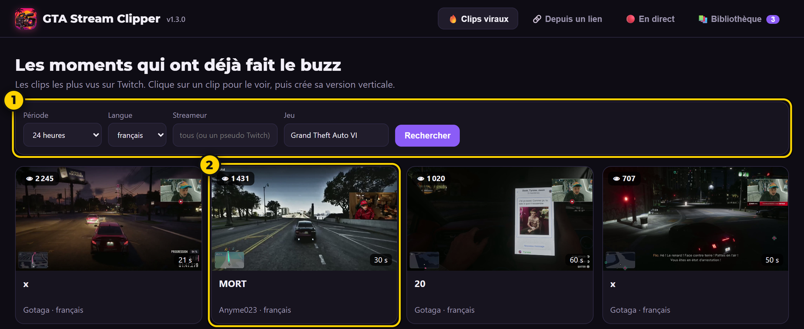
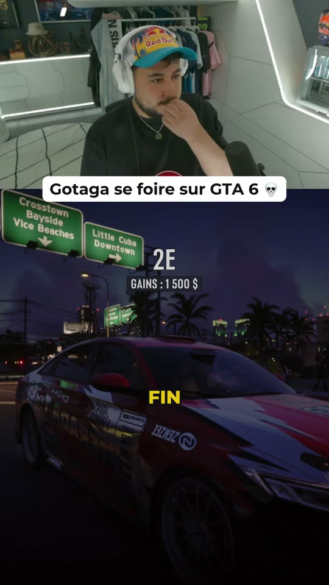
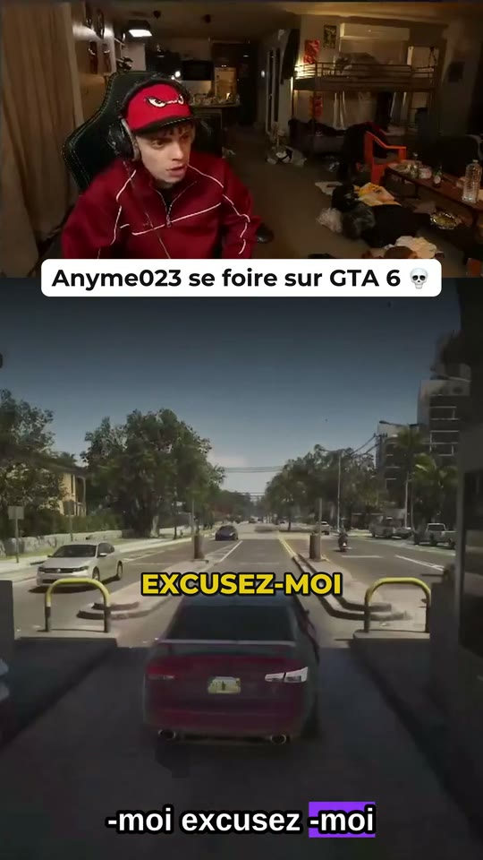
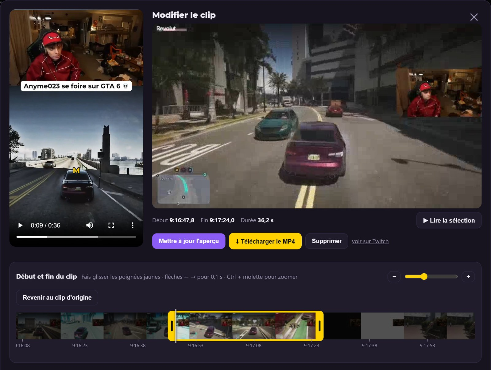

<p align="center"></p>

<h1 align="center">GTA Stream Clipper</h1>

<p align="center"><b>Des streams GTA 6 aux clips verticaux prêts à poster.</b><br>
Il trouve les moments qui ont déjà fait le buzz sur Twitch, ou il écoute une rediffusion (Twitch, Kick) ou un live,
et sort des clips 1080x1920 : la webcam du streameur en haut, le jeu en dessous, un titre avec emojis et les
sous-titres mot à mot. Gratuit, open source, sans compte et sans clé d'API.</p>

<p align="center">
  <a href="https://github.com/AlanECE/gta-stream-clipper/releases/latest/download/GTA-Stream-Clipper-Setup.exe"></a>
  &nbsp;
  <a href="https://github.com/AlanECE/gta-stream-clipper/releases/latest/download/GTA-Stream-Clipper-Mac.dmg"></a>
  <br><sub>Windows 10 / 11 (64 bits) · Mac à puce Apple (M1 et plus récents), macOS 12 ou plus · gratuit, sans compte</sub>
</p>

<p align="center"></p>

<p align="center">
  
  &nbsp;
  
  <br><sub>Deux clips viraux sortis par l'application, sans retouche</sub>
</p>

Une application (Windows et Mac), un outil en ligne de commande et un skill pour
[Claude Code](https://claude.com/claude-code), créés par [Alan (iAlan)](https://github.com/AlanECE). Licence MIT.
**Aucune clé d'API**, ni d'IA ni de Twitch : tout tourne sur ton ordinateur (ou ton serveur).

## Ce qu'il sait faire

- **🔥 Clips viraux** : les clips les plus vus sur Twitch (24 h, 7 jours, 30 jours), filtrés par langue ou par
  streameur. Tu regardes le clip, tu cliques : il reprend le clip tel quel (le moment exact, avec son vrai son) et le
  remet au format vertical, avec le titre et les sous-titres.
- **🔗 Depuis un lien** : une rediffusion Twitch ou Kick (YouTube marche aussi). Il écoute le stream, repère les moments
  où le streameur s'emballe et ceux où le chat explose (emotes, emojis, « MDR », « ????? »), et te les propose
  avec ce qu'il dit et les réactions du chat (💬 KEKW ×15 · MDR ×11).
- **🔴 En direct** : les lives GTA du moment (filtrés par langue). Tu en choisis un, il le regarde et sort un clip
  environ une minute après chaque moment fort. Avec la **veille**, il attend qu'une chaîne passe en direct, clippe,
  puis attend son live suivant : sur un serveur, il reste branché sur les lives jour et nuit.
- **📚 Bibliothèque** : tous tes clips. Aperçu, titre, sous-titres et style modifiables, puis téléchargement en MP4.
  Si la webcam est mal cadrée, tu traces son cadre à la souris sur l'image d'origine (ou tu choisis « pas de
  webcam »).
- **✂️ Timeline** : sous l'aperçu, le stream d'origine 2 minutes avant et après le clip. Tu fais glisser les deux
  poignées jaunes pour qu'il commence plus tôt ou plus tard, qu'il finisse plus tard ou plus tôt ; l'image du stream
  suit la poignée en direct, avec les temps de début et de fin (l'heure du live pour un clip en direct). Zoom pour
  être précis au dixième de seconde. Pour un clip viral, il va chercher les 2 minutes autour dans la rediffusion.

<p align="center"></p>

## Installation

### Sur Windows

1. Télécharge **[GTA-Stream-Clipper-Setup.exe](https://github.com/AlanECE/gta-stream-clipper/releases/latest/download/GTA-Stream-Clipper-Setup.exe)** et double-clique dessus.
2. Windows peut afficher « Windows a protégé votre ordinateur » (l'application n'est pas signée auprès de
   Microsoft) : clique sur **Informations complémentaires**, puis **Exécuter quand même**.
3. Clique sur **Installer**. Pas besoin d'être administrateur. Pendant l'installation, un tuto en 4 écrans montre où
   cliquer. Une icône **GTA Stream Clipper** est posée sur ton Bureau.
4. Lance-la : une fenêtre noire s'ouvre (c'est elle qui fait tourner l'application, la fermer arrête tout) et
   l'interface s'affiche dans ton navigateur. Tes clips sont rangés dans `Vidéos\GTA Stream Clipper`.

Pour la désinstaller : Paramètres → Applications → GTA Stream Clipper. Tes clips restent dans tes Vidéos.

Tu préfères sans installation ? La **[version portable](https://github.com/AlanECE/gta-stream-clipper/releases/latest/download/GTA-Stream-Clipper-Windows.zip)** : décompresse le zip
et double-clique sur `GTA-Stream-Clipper.exe`.

### Sur Mac

1. Télécharge **[GTA-Stream-Clipper-Mac.dmg](https://github.com/AlanECE/gta-stream-clipper/releases/latest/download/GTA-Stream-Clipper-Mac.dmg)**, ouvre-le et glisse
   **GTA Stream Clipper** dans le dossier **Applications**.
2. Ouvre l'application. Comme elle n'est pas certifiée par Apple (le certificat coûte 99 $ par an), macOS la bloque la
   première fois : va dans **Réglages Système → Confidentialité et sécurité**, descends jusqu'au message sur
   GTA Stream Clipper et clique sur **Ouvrir quand même**, puis confirme. Ce n'est à faire qu'une fois.
3. Une petite fenêtre GTA Stream Clipper s'ouvre, et l'interface s'affiche dans ton navigateur. Fermer cette fenêtre
   (ou `⌘ Cmd + Q`) arrête l'application. Tes clips sont rangés dans `Films/GTA Stream Clipper`.

Si macOS dit que l'application est endommagée, ou si rien ne se passe à l'ouverture : ouvre le Terminal, tape
`xattr -dr com.apple.quarantine "/Applications/GTA Stream Clipper.app"`, puis relance l'application.

### Bon à savoir sur l'application

Au premier clip, le modèle de transcription se télécharge (0,5 Go), une seule fois. L'application transcrit sur le
processeur (un clip de 30 secondes prend 20 à 40 secondes) ; pour utiliser une carte NVIDIA, bien plus rapide sur un
long stream, installe la version Python ci-dessous.

### Avec Claude Code

Colle ce message dans Claude Code :

```text
Installe GTA Stream Clipper depuis https://github.com/AlanECE/gta-stream-clipper :
clone le dépôt dans mon dossier personnel, installe FFmpeg s'il manque
(Windows : winget install Gyan.FFmpeg ; Mac : brew install ffmpeg),
puis lance pip install -r requirements.txt dans le dossier.
Si j'ai une carte NVIDIA, installe aussi nvidia-cublas-cu12 et nvidia-cudnn-cu12==9.*.
Copie le dossier skills/gta-stream-clipper dans ~/.claude/skills/.
Vérifie avec python -m clipper --help et dis-moi si c'est prêt.
```

Ensuite : **« ouvre l'interface de GTA Stream Clipper »**, **« trouve les clips GTA 6 français les plus vus
aujourd'hui et monte les 3 meilleurs »**, **« clippe ce stream <lien> »** ou **« surveille le live de domingo
pendant une heure »**.

### À la main

Il faut **Python 3.10 ou plus** et **FFmpeg** (`winget install Gyan.FFmpeg`, `brew install ffmpeg` ou
`sudo apt install ffmpeg`).

```bash
git clone https://github.com/AlanECE/gta-stream-clipper.git
cd gta-stream-clipper
pip install -r requirements.txt
# carte NVIDIA (transcription bien plus rapide), optionnel :
pip install nvidia-cublas-cu12 "nvidia-cudnn-cu12==9.*"
python -m clipper app      # l'interface dans le navigateur
```

## En ligne de commande

Toutes les commandes se lancent depuis le dossier du dépôt. Les clips arrivent dans `./clips/` : pour chacun, un
`.mp4`, un `.txt` (titre, légende avec hashtags, lien vers le moment dans le stream, ce que dit le streameur) et un
`.json` (pour le refaire).

```bash
# l'interface graphique
python -m clipper app

# les clips viraux : liste, puis montage
python -m clipper viral --langue-clips fr --liste             # les clips GTA 6 français les plus vus (24 h)
python -m clipper viral --langue-clips fr --choix 1,4         # monter le 1er et le 4e
python -m clipper viral --chaine kaicenat --periode semaine --nb 3

# un lien de rediffusion (Twitch, Kick, YouTube)
python -m clipper lien https://www.twitch.tv/videos/2935613960 --de 3:00:00 --a 3:45:00 --analyse
python -m clipper lien https://www.twitch.tv/videos/2935613960 --de 3:00:00 --a 3:45:00 --choix 1 --titres "Kai Cenat est bloqué sur GTA 6 😭"

# il cherche tout seul les dernières rediffusions GTA 6 (streamers.txt)
python -m clipper auto --liste
python -m clipper chaine kick:jolavanille

# un live : il écoute et sort les clips au fil de l'eau (Ctrl+C pour arrêter)
python -m clipper live domingo --minutes 120
python -m clipper live domingo --veille --minutes 0           # attend ses lives, l'un après l'autre, sans limite

# refaire un clip : autre titre, mot par mot, autre style
python -m clipper refaire clips/<clip>.json --titre "{streamer} panique sur {jeu} 😱" --mots 1 --style boite-violette
```

### Options utiles

| Option | Rôle | Par défaut |
|---|---|---|
| `--style` | sous-titres : `jaune` (mot dit en jaune), `tout-jaune`, `blanc`, `boite-jaune`, `boite-violette`, `boite-rouge`, `boite-verte`, ou `#RRGGBB` | `jaune` |
| `--mots` | mots affichés à la fois : 1 (mot par mot), 2 ou 3 | 2 |
| `--titre` | titre imposé ; `{streamer}` et `{jeu}` sont remplacés, emojis acceptés | automatique |
| `--titre-langue` | langue des titres automatiques (`fr` ou `en`) | `fr` |
| `--sans-titre` | pas de titre sur la vidéo | |
| `--jeu` | nom du jeu dans le titre | `GTA 6` |
| `--nb`, `--duree` | nombre de clips, durée visée d'un clip (secondes) | 3, 30 |
| `--de`, `--a` | plage du stream à analyser (`1:30:00`) | tout (10 h au plus) |
| `--langue` | langue parlée par le streameur (`en`, `fr`…) | détectée |
| `--sans-chat` | ne pas regarder le chat (le son et les paroles suffisent) | |
| `--cam x,y,l,h` | cadre de la webcam à la main, si la détection se trompe | automatique |
| `--separateur` | une bande jaune entre webcam et gameplay | |

## Sur un serveur : toujours branché sur les lives

Sur un serveur Linux (VPS), l'outil tourne même PC éteint. L'interface est la même, dans ton navigateur, protégée
par un mot de passe :

```bash
sudo apt install -y ffmpeg python3-pip git tmux
git clone https://github.com/AlanECE/gta-stream-clipper.git && cd gta-stream-clipper
pip install -r requirements.txt
tmux new -s clipper
python3 -m clipper app --host 0.0.0.0 --port 8765 --mot-de-passe "un-mot-de-passe-solide" --sans-navigateur
```

Ouvre `http://<ip-du-serveur>:8765` (utilisateur `clipper`), puis dans l'onglet « En direct » tape le pseudo d'un
streameur, coche **Veille**, mets 0 minute (sans limite) et clique sur « Surveiller » : l'outil attend ses lives, les
clippe l'un après l'autre, et les clips arrivent dans la bibliothèque. Tu les modifies et les télécharges depuis
n'importe où. Il ne garde sur le disque que les 15 dernières minutes du live, plus l'extrait de chaque clip.
`tmux` garde l'outil ouvert quand tu te déconnectes (`Ctrl+B` puis `D` ; `tmux attach -t clipper` pour revenir).
Sans carte graphique, la transcription tourne sur le processeur : prends au moins 4 cœurs pour suivre un live.
Pour un vrai nom de domaine en HTTPS, mets un proxy (Caddy, Nginx) devant le port 8765.

## Comment ça marche

| Étape | Ce qu'il fait |
|---|---|
| Clips viraux | l'accès public du site Twitch (le même que yt-dlp) donne les clips les plus vus ; chaque clip est repris tel quel, avec son vrai son |
| Moments d'un stream | le volume de sa voix par rapport à son niveau normal, et le chat Twitch ou YouTube : sa vitesse, et surtout ses réactions (emotes KEKW ou LUL, emojis 😂, « MDR », « PTN », « ????? », cris en majuscules) bien au-dessus de l'habitude du stream |
| Paroles | Whisper (faster-whisper) transcrit chaque moment sur ton ordinateur ; les mots de réaction (« bro », « chat », « oh my god »…) font monter le score |
| Cinématiques | les bandes noires des scènes du jeu font baisser le score (les paroles sont celles des personnages) |
| Webcam | un visage qui ne bouge pas pendant que le jeu bouge, et les bordures nettes autour de lui (le même cadre pour tout le stream) ; une webcam sans bordure est cadrée autour du visage |
| Clip | webcam en haut (un tiers), jeu en bas, titre en boîte blanche sur la jonction, sous-titres mot à mot, son normalisé à -14 LUFS |

Le chat n'est **ni gardé ni affiché** : seules ses réactions sont comptées, moment par moment. S'il n'y a pas de webcam, le jeu est posé au centre sur un fond flouté ; si le
streameur est en plein écran, l'image est recadrée sur lui.

## Bon à savoir

- **Clippe seulement des streameurs d'accord pour être clippés**, et regarde chaque clip avant de le poster. Beaucoup
  de streameurs ont un programme de clippeurs ; renseigne-toi avant.
- La détection des moments d'un stream se trompe parfois (une scène du jeu très bruyante, un dialogue de mission) :
  regarde la liste avant de monter. Les clips viraux, eux, ont déjà été choisis par les viewers.
- Les rediffusions réservées aux abonnés ne se téléchargent pas (onglet « Depuis un lien »). Les clips viraux, eux,
  se téléchargent toujours : c'est le clip Twitch lui-même qui est repris.
- La webcam est trouvée toute seule dans la plupart des cas. Quand elle ne l'est pas (webcam détourée, très sombre,
  dessin posé sur le stream), trace son cadre dans l'éditeur du clip.
- L'extrait source de chaque clip (2 minutes avant et après) reste dans le dossier `.travail` pour pouvoir le
  modifier et le rallonger ; supprimer un clip dans la bibliothèque supprime aussi son extrait.

## Construire l'application

```bash
pip install -r requirements.txt pyinstaller
python build_exe.py
```

- **Windows** : `dist/GTA-Stream-Clipper/`, la version portable `dist/GTA-Stream-Clipper-Windows.zip` et, si
  [Inno Setup 6](https://jrsoftware.org/isinfo.php) est installé (ou indiqué par la variable `ISCC`), l'installeur
  `dist/GTA-Stream-Clipper-Setup.exe` (script : [`packaging/installer.iss`](packaging/installer.iss)).
- **Mac** (puce Apple) : `dist/GTA Stream Clipper.app` et `dist/GTA-Stream-Clipper-Mac.dmg`. Le workflow
  [Version Mac](.github/workflows/mac.yml) le construit sur un Mac de GitHub, le teste comme un utilisateur
  (double-clic, un vrai clip viral, l'éditeur, Quitter) et joint le `.dmg` à chaque release publiée.

## Crédits et licences

GTA Stream Clipper est sous licence [MIT](LICENSE). Il repose sur [yt-dlp](https://github.com/yt-dlp/yt-dlp)
(Unlicense), [FFmpeg](https://ffmpeg.org/) (l'application embarque la version « essentials » de
[gyan.dev](https://www.gyan.dev/ffmpeg/builds/) sous Windows et la version statique de
[Martin Riedl](https://ffmpeg.martin-riedl.de/) sur Mac, GPL), [faster-whisper](https://github.com/SYSTRAN/faster-whisper)
(MIT) et le modèle [Whisper](https://github.com/openai/whisper) d'OpenAI (MIT), [OpenCV](https://opencv.org/)
(Apache 2.0) et son détecteur de visages [YuNet](https://github.com/opencv/opencv_zoo/tree/main/models/face_detection_yunet)
(MIT, fourni dans `clipper/assets/models`), [Pillow](https://python-pillow.org/) (MIT-CMU) et la police
[Montserrat](https://github.com/JulietaUla/Montserrat) (SIL OFL 1.1). Les emojis Apple sont téléchargés au besoin
depuis le paquet public [emoji-datasource-apple](https://github.com/iamcal/emoji-data) et restent la propriété
d'Apple ; ils ne sont pas fournis dans ce dépôt. L'icône a été dessinée avec GPT Image 2.6.

L'idée vient de [gta6-clipper](https://github.com/vossashtonai/gta6-clipper) d'Ashton Voss (MIT). Le code est écrit de
zéro. GTA Stream Clipper n'est affilié ni à Rockstar Games, ni à Twitch, ni à Kick, ni à YouTube, ni aux streameurs
cités en exemple.
